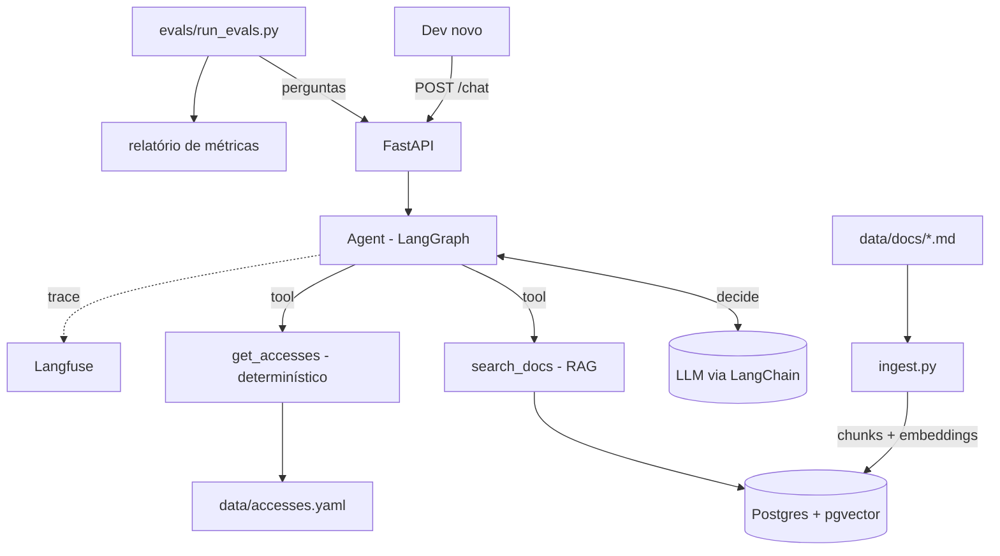

# Arquitetura — Onboarding Agent (POC)

Assistente que responde às dúvidas de um dev que acabou de entrar num projeto:
"quais acessos eu preciso?", "onde está o roadmap?", "com quem eu falo sobre deploy?".

Na POC, os dados são **fictícios** (um projeto inventado). Assim a gente não
esbarra em restrição de dado de cliente. Quando houver documentos reais, é só
trocar a pasta `data/`.

---

## Visão geral

```
                         ┌───────────────────────────┐
  dev novo ── pergunta ─▶│  API  (FastAPI)           │  POST /chat
  (curl / UI simples /   │  valida entrada (Pydantic)│
   Teams no futuro)      └─────────────┬─────────────┘
                                       │
                                       ▼
                         ┌───────────────────────────┐
                         │  AGENT  (LangGraph)       │
                         │  LLM decide: responder    │◀────── LLM (via LangChain)
                         │  direto ou chamar tool?   │
                         └──────┬─────────────┬──────┘
                                │             │
                 tool 1         ▼             ▼        tool 2
                 ┌──────────────────┐   ┌──────────────────────┐
                 │ search_docs      │   │ get_accesses         │
                 │ (RAG)            │   │ (código determinístico│
                 │ busca semântica  │   │  lê accesses.yaml)    │
                 └────────┬─────────┘   └──────────────────────┘
                          │
                          ▼
                 ┌──────────────────┐        ┌──────────────────┐
                 │ Postgres +       │◀───────│ ingest.py        │◀── data/docs/*.md
                 │ pgvector         │ chunks │ chunk + embedding│
                 └──────────────────┘        └──────────────────┘

  ─────────────────────────── transversal ───────────────────────────
  DOCKER COMPOSE   container "api" (FastAPI) + container "db" (Postgres/pgvector)
  OBSERVABILIDADE  Langfuse Cloud recebe o trace de cada request:
                   prompt, tools chamadas, chunks recuperados, tokens, custo, latência

  EVALS            evals/dataset.jsonl ──▶ run_evals.py ──▶ métricas ──▶ relatório
                   (roda o agent de verdade contra perguntas com resposta esperada)
```

### Mesma coisa em Mermaid (renderiza no GitHub e no preview do VS Code com extensão)



---

## Por que duas tools diferentes?

Essa é a decisão de arquitetura mais importante do projeto, e é pergunta clássica
de entrevista: **o que vai pro código e o que vai pro modelo?**

| Pergunta | Tool | Por quê |
|---|---|---|
| "Quais acessos preciso no projeto X?" | `get_accesses` | A resposta é uma **lista exata**. Se o LLM inventar ou esquecer um acesso, o dev descobre no meio do desenvolvimento, que é justamente a dor que a gente quer resolver. Por isso é código: lê o YAML e devolve. |
| "Como funciona o deploy?" | `search_docs` | A resposta está em **texto livre**, espalhada nos docs. Aqui o RAG é o ideal: busca os trechos e o LLM resume citando a fonte. |
| "Oi, tudo bem?" | nenhuma | O LLM responde direto. |

O LLM faz o roteamento (escolhe a tool) e a redação da resposta. Os dados exatos
vêm do código.

---

## Exemplo de uma request do começo ao fim

Pergunta: *"Entrei no projeto Loja X. Que acessos eu preciso e onde vejo o roadmap?"*

1. A **API** recebe o JSON e o Pydantic valida (`message` não pode vir vazio, etc.).
2. O **agent** manda a pergunta, com o system prompt e a descrição das tools, para o LLM.
3. O LLM responde: "chamar `get_accesses(project="loja-x")` e `search_docs("roadmap loja x")`".
4. O LangGraph **executa as tools**:
   - `get_accesses` lê o YAML e devolve `[GitHub, Jira, Mirakl (sob demanda), ...]`
   - `search_docs` gera o embedding da busca, pega os top-k chunks no pgvector e devolve o texto com a fonte
5. O resultado das tools volta para o LLM, que **redige a resposta final** citando as fontes.
6. A API devolve `{ answer, sources, tools_used }`.
7. O **Langfuse** guarda o trace inteiro: dá para abrir e ver cada passo, o custo e o tempo.

---

## Estrutura de pastas (alvo)

```
onboarding-agent/
├── app/
│   ├── api.py            # FastAPI: rotas, schemas de request/response
│   ├── config.py         # settings via env (.env)
│   ├── llm.py            # cria o modelo (troca de provider num lugar só)
│   ├── agent/
│   │   ├── graph.py      # grafo LangGraph
│   │   ├── tools.py      # search_docs, get_accesses
│   │   └── prompts.py    # system prompt versionado
│   └── rag/
│       ├── ingest.py     # md → chunks → embeddings → pgvector
│       └── retriever.py  # busca top-k
├── data/
│   ├── docs/             # docs fictícios do projeto (README, roadmap, deploy, contatos)
│   └── accesses.yaml     # catálogo de acessos (mínimos vs sob demanda)
├── evals/
│   ├── dataset.jsonl     # pergunta + resposta esperada + fonte/tool esperada
│   └── run_evals.py
├── tests/                # pytest (unidade + API)
├── docs/decisoes.md      # registro de decisões (ADR)
├── .env.example
├── pyproject.toml
├── Dockerfile
└── docker-compose.yml    # api + db (Postgres/pgvector); Langfuse fica na nuvem
```

A estrutura cresce fase a fase. Não precisa criar tudo de uma vez (ver `ROADMAP.md`).

---

## Fora do escopo da POC (de propósito)

- Integração com Microsoft Teams: fica por último, depois que o núcleo funcionar
- Autenticação de usuário de verdade: na POC, basta uma API key no header
- Front-end caprichado: curl, Swagger (`/docs`) ou uma página HTML simples já bastam
- Memória de longo prazo entre conversas
