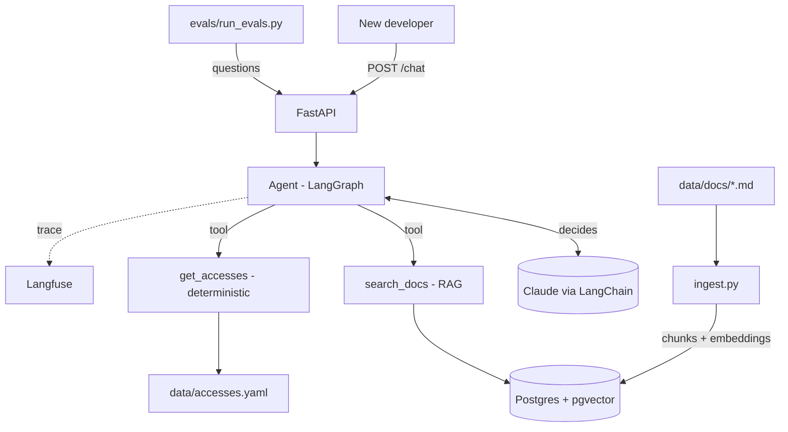

# Onboarding Agent

An AI assistant that answers the questions a developer has in their first weeks on a
project — *"which accesses do I need?"*, *"how do I deploy?"*, *"who do I talk to about X?"* —
using RAG over the project's docs and deterministic tools for exact data.

> **Status:** proof of concept, built phase by phase (see [Roadmap](#roadmap)).
> All project data is fictional, so there are no client-data constraints.

---

## Why

Onboarding knowledge is scattered across READMEs, wikis and people's heads. New developers
lose days asking the same questions, and a missing access is usually discovered in the middle
of a task. This project explores how far an agent can go in answering these questions
**with sources**, and how to **measure** whether it actually gets them right.

## Architecture



**Key design choice — what goes to code vs. to the model:** access lists are exact data, so
they come from a deterministic tool (an LLM that forgets one access causes the exact pain this
project is meant to remove). Free-text knowledge goes through RAG, and the LLM summarizes it
citing the source. Full design in [`ARQUITETURA.md`](ARQUITETURA.md) (Portuguese).

**Implemented today:** FastAPI + Claude chat endpoint, token counting, Langfuse tracing,
Postgres/pgvector in Docker. The agent, tools and RAG pipeline are the next phases.

## Tech stack

| Layer | Choice |
|---|---|
| API | Python 3.12, FastAPI, Pydantic |
| LLM | Anthropic Claude via LangChain (`langchain-anthropic`) |
| Agent | LangGraph *(Phase 5)* |
| Vector store | Postgres + pgvector |
| Observability | Langfuse Cloud (LangChain `CallbackHandler`) |
| Packaging | uv |
| Infra | Docker Compose (local), AWS *(Phase 8)* |
| Tests | pytest, FastAPI `TestClient`, mocked LLM |

## Key decisions

Every relevant choice is recorded with options, the **tradeoff accepted** and **when to
revisit** it, in [`docs/decisoes.md`](docs/decisoes.md) (Portuguese).

| # | Decision | Tradeoff accepted |
|---|---|---|
| D1 | Claude via LangChain | Data goes to the Anthropic API; new API features may lag in LangChain |
| D2 | uv as package manager | Newer tool; contributors need to install it |
| D3 | pgvector in Docker Compose | Run Postgres from day one; a dedicated vector DB tends to be faster at tens of millions of vectors |
| D4 | Langfuse Cloud | Full traces stored outside our infra; a few seconds of delay to show up |
| D7 | System prompt v3 | Input prompt 2.3× larger; fixed format feels less natural in casual chat |
| D8 | Langfuse via `CallbackHandler` + span filter | Drops non-Langfuse spans; anything outside LangChain isn't traced |
| D10 | Keep the model's default thinking until evals exist | Paying ~1/3 more output tokens without knowing the quality gain |

**Things I saw break:** the first Langfuse integration **doubled the reported cost** — both the
LangChain callback and the Anthropic SDK instrumentation were emitting a generation for the
same call. Fixed by filtering the SDK span (D8).

Reviewing a trace also showed that **~1/3 of output tokens were hidden reasoning**: the model
thinks by default and returns an empty `thinking` block, but bills it as output (~525 output
tokens with thinking vs ~348 without, for answers of similar length). Kept as is for now, to be
decided with evals comparing quality vs. cost (D10).

## Evaluation

*Coming in Phase 4.* Planned metrics: retrieval precision@k / recall@k, LLM-as-judge
groundedness, and tool-selection accuracy for the agent, with results compared across
versions in Langfuse.

Prompt engineering so far: 3 system prompt versions compared on the same 5 questions,
measuring output tokens, latency and behavior when the answer is unknown —
see [`experiments/`](experiments/).

## Running locally

Requirements: Docker and [uv](https://docs.astral.sh/uv/).

```bash
cp .env.example .env        # fill in ANTHROPIC_API_KEY and Langfuse keys
docker compose up -d --build
curl localhost:8010/health  # {"status":"ok","db":"ok"}
```

```bash
curl -X POST localhost:8010/chat \
  -H "Content-Type: application/json" \
  -d '{"message": "I just joined the project, where do I start?"}'
```

### Endpoints

| Method | Path | What it does |
|---|---|---|
| GET | `/health` | API + database check (`503` if the DB is down) |
| POST | `/chat` | Answers a message; returns `answer` and token `usage` |
| POST | `/chat/count-tokens` | Counts input tokens before calling the model (Anthropic `count_tokens`) |

## Tests

```bash
uv run pytest -q
```

The LLM is mocked in tests, so they don't depend on an external API or cost tokens.

## Roadmap

- [x] Phase 0 — Setup, Docker, `/health`
- [x] Phase 1 — LLM call and prompt engineering
- [x] Phase 2 — Observability (Langfuse)
- [ ] Phase 3 — RAG with pgvector
- [ ] Phase 4 — Evals v1
- [ ] Phase 5 — Agent with LangGraph
- [ ] Phase 6 — Agent evals
- [ ] Phase 7 — Production hardening (errors, auth, guardrails, CI)
- [ ] Phase 8 — AWS deploy
- [ ] Phase 9 — Wrap-up

Detailed plan in [`ROADMAP.md`](ROADMAP.md) (Portuguese).

## Limitations

- Fictional data only; no real documents yet.
- No agent or retrieval yet — `/chat` currently calls the LLM directly.
- No authentication or rate limiting (Phase 7).
